# Climbing animation: editable source and animator's guide

Status: 0.2.7 development. The climbing animation is authored in **`LadderGait.blend`** (Blender 5.1) and exported
into `Domain/Animation/GeneratedGait.cs`, which is what the game runs. The motion is original: no purchased, stock or
extracted game animation, rig or clip is used.

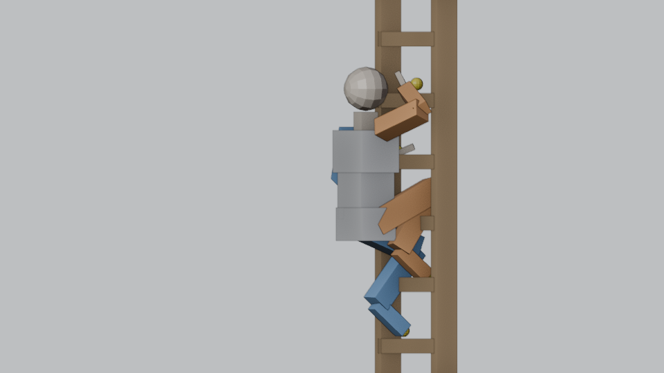

## Contents

1. [What is here](#what-is-here)
2. [Open the file](#open-the-file)
3. [The scene](#the-scene)
4. [The controls](#the-controls)
5. [Edit a climbing loop](#edit-a-climbing-loop-climb_up-climb_down)
6. [Edit a transition](#edit-a-transition)
7. [Edit the posture, bend and stance values](#edit-the-posture-bend-and-stance-values)
8. [Export, regenerate, test](#export-regenerate-test)
9. [The frame tables](#the-frame-tables-frames-action-csv)
10. [Into the game](#into-the-game)
11. [Screenshots](#screenshots)
12. [Rules the exporter and the game enforce](#rules-the-exporter-and-the-game-enforce)
13. [Reference choices, ownership, known limits](#reference-choices)

## What is here

| File | What it is | Edit it? |
|---|---|---|
| `LadderGait.blend` | the source: proxy climber, ladder, controls, eight actions | **yes, in Blender** |
| `ladder_gait.json` | every exported value (both loops, six transitions, constants) | no, generated |
| `frames/<action>.csv` | one row per frame of each action: control values and derived channels | no, generated |
| `guide/*.png` | the screenshots below (rendered from the .blend) | no, generated |
| `../Domain/Animation/GeneratedGait.cs` | the C# the game runs | no, generated |
| `../Runtime/Animation/ClimbTuning.cs` | values measured against the game rig (grip and sole offsets, rails, reach limit) | yes, in code |

The tools are in `tools/animation/gait/`:

| Tool | Does |
|---|---|
| `regenerate.ps1` | export the saved .blend, compile the C#, check (the one command you normally run) |
| `export_gait.py` | .blend → `ladder_gait.json` + `frames/*.csv` (run inside Blender) |
| `compile_gait.py` | JSON → `GeneratedGait.cs`; `--check` fails if anything is stale |
| `set_props.py` | set static values from the command line (also `regenerate.ps1 CTL_Bend.knee_toward=0.3`) |
| `render_guide.py` | re-render the screenshots in `guide/` |
| `build_gait_blend.py` | **start over**: rebuild the .blend from the C# defaults (overwrites every edit) |
| `round_trip_edit.py` | the scripted edit used for the round-trip proof (scratch copies only) |
| `gait_model.py`, `gait_blend.py` | shared code: the data contract, the C# defaults, the preview |

## Open the file

1. Open `LadderGait.blend` in Blender 5.1.
2. Blender asks whether to run the file's script (`ladder_preview.py`). Choose **Allow Execution** (or, if you
   dismissed it, open the *Scripting* workspace, pick `ladder_preview.py` in the Text Editor and press *Run Script*).
   The script only poses the preview: it reads the actions on every frame change and places the proxy climber's
   rung contacts. It writes nothing else and is not needed for exporting.
3. Scrub the timeline (frames 0–120). The proxy climbs. After you move keys, change the frame (←/→) to refresh the
   preview.

Without the script the controls still show their keyed offsets, but the proxy does not follow the rungs.

## The scene

All lengths are metres, angles degrees, times fractions of a cycle or of a transition's progress.

* **Ladder**: rails, 15 rungs at the runtime pitch (1/3 m, rung 0 at 1/6 m), the **ground**, an **upper floor**
  at the ladder top (5 m) and an **intermediate floor** to the climber's left (2 m).
* **World axes**: the rungs' centre plane is Y = 0; the climber stands on +Y and faces −Y (toward the ladder); up is
  +Z; the climber's **left is +X** (Blender's `.L` side).
* **RIG** (armature): the controls. Select it, enter *Pose Mode*.
  * `CTL_*` bones are what you key or set (yellow spheres mark the limb and pelvis controls).
  * `PRV_*` bones are placed by the preview script (rung contacts, pelvis base, elbow and knee hints). Never key them.
  * `IKT_*` bones are the wrist and ankle goals hanging off the limb controls. Leave them alone.
* **PROXY** (armature with meshes): a proxy humanoid proportioned to the Valheim player (pelvis about 0.95 m,
  shoulders 1.43 m, leg chain 0.9 m like the native rig). Blue is the left side, orange the right. It is posed by IK;
  you never key it.
* **Cameras**: `CAM_Front` (behind the climber, square to the ladder) and `CAM_Side` (from behind the right
  shoulder, 25° off the side). Both follow the climber. In the 3D view: *View → Cameras → Set Active Object as
  Camera* with one selected, then Numpad 0.
* **Timeline**: frames 0–120 for every action, 108 fps (one ascent cycle in 1.11 s, the owner's 0.9 m/s).

## The controls

| Control | Channel | Means | Used by |
|---|---|---|---|
| `CTL_Hand.L/.R`, `CTL_Foot.L/.R` | Location X | extra offset toward the limb's **own** side (+X for `.L`, **−X for `.R`**, mirrored) | all actions |
| | Location Y | offset away from the rungs (toward the climber) | all actions |
| | Location Z | offset upward | all actions |
| | `["weight"]` 0–1 | how much the authored contact owns the limb (0 = the game's own pose) | transitions |
| | `["reach"]` 0–1 | 0 = the limb's ladder contact, 1 = its floor contact | transitions |
| `CTL_Pelvis` | Location Z | body offset up | all actions |
| | Location Y | body offset **away from** the rungs (C# `toward` is −Y) | all actions |
| | Rotation X | extra lean toward the ladder (degrees in the UI) | all actions |
| | `["weight"]` 0–1 | body weight: 1 = climbing posture, 0 = the game's own pose | transitions |
| `CTL_Swing` | `["ease"]` 0–1 | how far along its rung-to-rung travel a moving limb is, over its move | loops |
| `RIG` (object) | `["seconds"]` | duration of a mount or a catch | transitions |
| `CTL_Gait` | static properties | stride and stance, settling (see below) | — |
| `CTL_Pelvis` | static properties | posture constants (see below) | — |
| `CTL_Bend` | static properties | elbow and knee bend hints (see below) | — |

Pick an action: select `RIG`, open the **Dope Sheet → Action Editor** and choose it from the action list. All eight
are also NLA tracks (*Nonlinear Animation* editor, muted) so they sit side by side; the active action is what you
edit and what the preview shows.

| Action | C# | Timeline means |
|---|---|---|
| `climb_up` | `GaitShape.Up` | one ascent cycle in time order; cycle phase = frame / 120 |
| `climb_down` | `GaitShape.Down` | one descent cycle in time order (the body moves down, so phase = 1 − frame / 120) |
| `GroundMount` | `TransitionKind.GroundMount` | progress = frame / 120 (41 samples, every 3 frames) |
| `AirCatch` | `TransitionKind.AirCatch` | 〃 |
| `TopExit` | `TransitionKind.TopExit` (upper exit) | 〃 |
| `SideExit` | `TransitionKind.SideExit` (intermediate exit) | 〃 |
| `BottomStepOff` | `TransitionKind.BottomStepOff` | 〃 |
| `TopEntry` | `TransitionKind.TopEntry` (descending entry) | 〃 |

Keys are linear and the defaults are dense (one key per exported sample) so a no-edit export gives back exactly the
code's values. You may use any interpolation, delete keys, or add your own: the exporter samples the F-curves.
Handy: in the Graph Editor select a range of keys and scale them (S, then Y) with *Proportional Editing* (O) for a
smooth change, or use *Key → Smooth Keys*.

## Edit a climbing loop (`climb_up`, `climb_down`)

A cycle is one move of every limb; the body travels `stride_rungs` rungs (3 = 1 m) per cycle.

**Timing of a limb: move its block of keys.** Each limb control has a contiguous block of keys on its three
location channels. The **first and last key are the limb's window**: where the block sits is when the limb lets go
and lands, its length is how long the limb is off the rungs. In the Dope Sheet select all keys of, say,
`CTL_Hand.L` and press G to slide them (later = the limb moves later in the climb), or S to make the move longer or
shorter (0.05–0.7 of a cycle). A block may run past frame 120: the move continues into the next cycle and the
preview wraps it. Exported as `Start` / `Length` (fractions of the cycle, for the descent counted on the backward
phase).

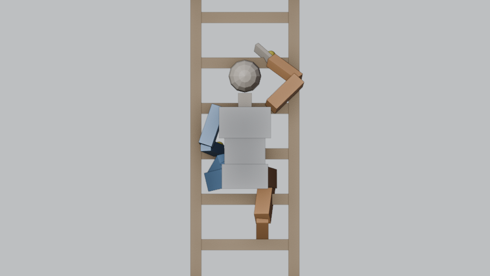

**Path of a limb: the location values of its block.** Z is how high the hand or foot lifts on its way, Y how far it
draws away from the rungs (a knee-led foot recovery draws back first, then rises), X toward its own side. Outside the
block the control rests at zero (on the rung). Exported as `Arc` (33 samples over the limb's move).

**Ease of a reach: `CTL_Swing["ease"]`.** A curve 0→1 over frames 0–120 = the move's own progress (leave slowly,
travel, settle). Shared by the four limbs of that loop. Exported as `Swing`.

**Torso: `CTL_Pelvis`.** Location Z over the cycle is the body's offset from steady travel: lower values while a
foot recovers (the torso dwells), then a faster rise as the supporting leg extends. Keep the curve's mean near zero
and its start equal to its end (it is a loop). Location Y is the in/out offset, Rotation X extra lean. Exported as
`Body` (61 samples: up, toward) and `Lean`.

The descent is its own loop (a controlled lowering, not the ascent reversed): the lower foot reaches down first while
the supporting leg bends, then the opposite hand comes down.

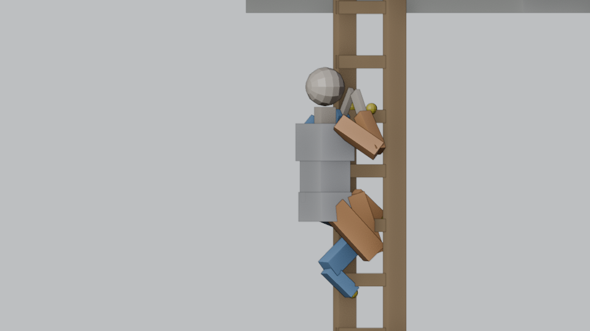

## Edit a transition

Progress 0 → 1 runs over frames 0–120. For the exits and the top entry, progress is the runtime route's progress
(the visual contacts never lead the real capsule); for a mount and a catch, it is time over `RIG["seconds"]`.

* **Hand-over between the game's pose and the climb: `["weight"]`** on each limb control and on `CTL_Pelvis`.
  Entries ramp 0 → 1 (the game's own pose to the climbing contact), exits ramp 1 → 0 at their end so the game's walk
  takes over.
* **Ladder to floor: `["reach"]`** on each limb. 0 = the limb's climbing contact on the ladder, 1 = its floor
  contact (the landing; for `TopEntry` the floor it starts from).
* **Extra path: location** on each limb control (a knee-led foot over the lip, a hand moving ahead onto the floor).
* **Body: `CTL_Pelvis`** location Z / Y and rotation X, added to the climbing posture.

Example: to make the lead foot clear the lip higher on the upper exit, select `CTL_Foot.L` in `TopExit`, in the Graph
Editor show only *Z Location*, select the keys of the bump (frames 18–60) and scale them up.

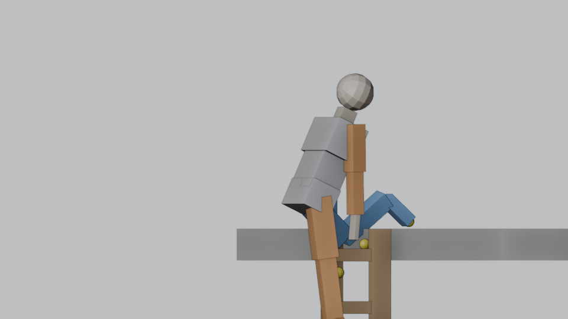

## Edit the posture, bend and stance values

These are **static** (never keyed; the exporter refuses a keyed one). Select the bone in Pose Mode and edit
*Bone Properties → Custom Properties*, or from a terminal: `pwsh tools/animation/gait/regenerate.ps1 CTL_Bend.knee_toward=0.3`.

| Bone | Property | C# | Means |
|---|---|---|---|
| `CTL_Pelvis` | `pelvis_drop`, `pelvis_toward` | `PelvisDrop`, `PelvisToward` | pelvis below the rig's standing estimate; how close the hips hang to the rungs |
| | `lean`, `slide_lean` | `Lean`, `SlideLean` | torso pitch toward the ladder while climbing / sliding |
| | `sway_tilt`, `sway_shift` | `SwayTilt`, `SwayShift` | side tilt and shift per unit of limb sway |
| `CTL_Bend` | `elbow_out`, `elbow_side`, `elbow_down` | `ElbowOut/Side/Down` | elbow hint from the shoulder: out from the rungs, to its side, down |
| | `knee_toward`, `knee_side`, `knee_down` | `KneeToward/Side/Down` | knee hint from the hip: toward the rungs, to its side, down |
| `CTL_Gait` | `stride_rungs` | `ClimbLoop.StrideRungs` | rungs per limb move and per cycle (both loops) |
| | `foot_low_rel`, `hand_mid_from_shoulder` | `GaitShape.FootLowRel`, `HandMidFromShoulder` | where feet and hands sit on the rungs relative to the body |
| | `hand_/foot_settle_below/above` | `GaitShape.*Settle*` | the band a limb settles into when the climber stops |
| | `settle_seconds`, `rejoin_seconds`, `reverse_seconds` | `GaitShape.*Seconds` | settling, rejoining and reversal blend times |

The preview places the proxy's elbow and knee hints from `CTL_Bend`, so a bend change is visible after a frame
change.

## Export, regenerate, test

From the repository root, after saving the .blend:

```powershell
pwsh tools/animation/gait/regenerate.ps1          # export + compile + check
pwsh tools/animation/gait/regenerate.ps1 -Check   # only check (also: python tools/animation/gait/compile_gait.py --check)
dotnet build src/ConcernedLadders/ConcernedLadders.csproj -c Release -p:SolutionDir=<repo>\
dotnet test src/ConcernedLadders.Tests/ConcernedLadders.Tests.csproj -c Release
```

`regenerate.ps1` rewrites `ladder_gait.json`, `frames/*.csv` and `GeneratedGait.cs`. Review the diff of
`GeneratedGait.cs`: it should change exactly the channels you edited. `--check` fails when the .blend was saved but
not exported, or when the C# was edited by hand. Blender is expected at
`C:\Program Files\Blender Foundation\Blender 5.1\blender.exe` (set `$env:BLENDER` otherwise).

### When a test fails after an edit

`GeneratedGaitTests.TheExportMatchesTheCodeDefaults` pins the exported data to the C# defaults it was seeded from
(`LimbGait.cs` loops, `DefaultTransitions`, the former constants). After a deliberate edit it fails and lists each
channel that moved, e.g. `Up.Arc[LF].up: 31 value(s), first Up.Arc[LF][1].up 0.00048 -> 0.00072`. That list is your
review: it must name only what you meant to change. Accepting the change is an owner decision: once accepted in
game, update the pinned defaults (or retire the pin) in the same change. Every other test must keep passing
(`TheExportIsValid`, the gait and transition tests).

## The frame tables (`frames/<action>.csv`)

One row per frame 0–120 of each action, recomputed on every export. These are the authored **targets** on the
reference ladder; the game fits them to the live rig and the real route (the `Climb fit` log lines and the
development contact trace show the solved positions).

| Column | Meaning |
|---|---|
| `frame`, `time` | frame and frame / 120 |
| `phase` / `progress` | cycle phase (loops) or transition progress |
| `feet_x/y/z` | the body root (feet) in the reference scene |
| `<L>_key_x/y/z` | the limb control's keyed location at this frame (as in Blender: X mirrored for the right side) |
| `<L>_state`, `<L>_swing`, `<L>_rung_from/to` | loops: planted / release / reach / approach, the move's progress, the rungs it moves between |
| `<L>_weight`, `<L>_reach` | transitions: the two channels at this progress |
| `<L>_arc_lat/out/up` | the exported arc at this frame (ladder space: lat toward its own side) |
| `<L>_rung_z` | the rung centre height the limb holds or travels along |
| `<L>_target_x/y/z` | the final contact (palm centre / ball of the foot) in the scene |
| `pelvis_key_y/z`, `pelvis_key_lean_deg` | `CTL_Pelvis` keyed values |
| `swing_ease_key` / `body_weight` | loops: `CTL_Swing["ease"]` at this frame; transitions: body weight |
| `body_up`, `body_toward`, `body_lean_deg` | the exported body channels at this phase or progress |
| `seconds` | transitions: `RIG["seconds"]` |
| `pelvis_x/y/z`, `pelvis_lean_total_deg` | the climbing pelvis and its total lean (constant lean + curve) |

`<L>` is `LH`, `RH`, `LF`, `RF`.

## Into the game

The game reads only `GeneratedGait.cs`; the .blend, JSON and CSVs are not shipped. After regenerating:

1. `pwsh scripts/verify.ps1` (the gate: build, every test, validator).
2. Package and deploy are the lead's steps (`scripts/package.ps1`, `scripts/deploy.ps1` into the test profile).
3. In game, climb up and down, stop and reverse, mount, catch, and use every exit. The plugin logs the source it
   runs at startup: `Climbing gait source LadderGait.blend <sha12> (Blender 5.1.2)`; the `Climb fit` lines report
   per limb how far each contact asked of the chain and whether any was skipped (`skip=0` is a fitted motion).

## Screenshots

Rendered by `render_guide.py` (Workbench, 960×540). Yellow spheres are the limb and pelvis controls.

| | |
|---|---|
| 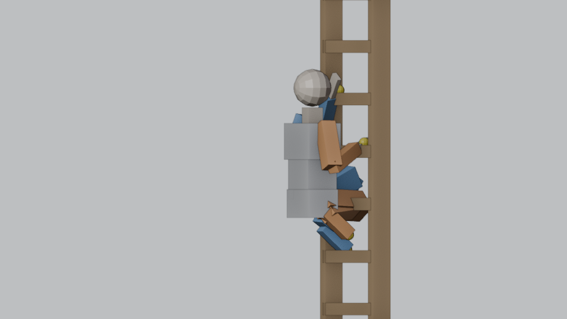 `climb_up` frame 0 | 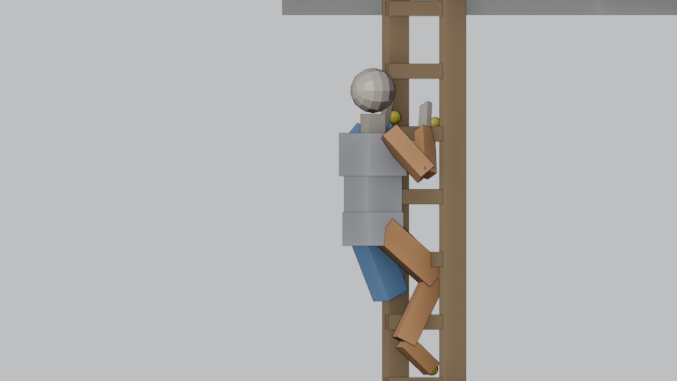 `climb_up` frame 90 |
| 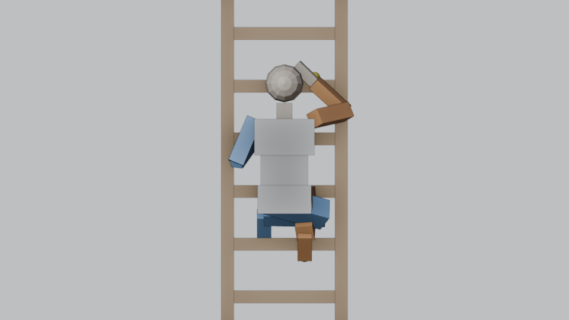 `climb_down` frame 90 | 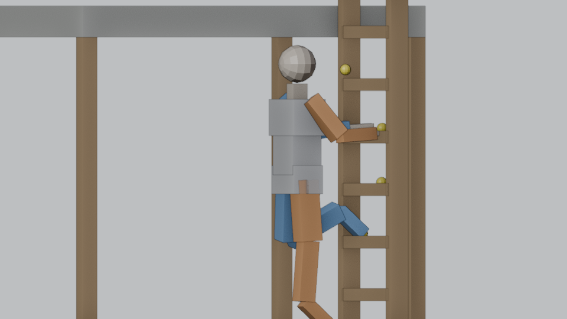 `GroundMount` frame 60 |
| 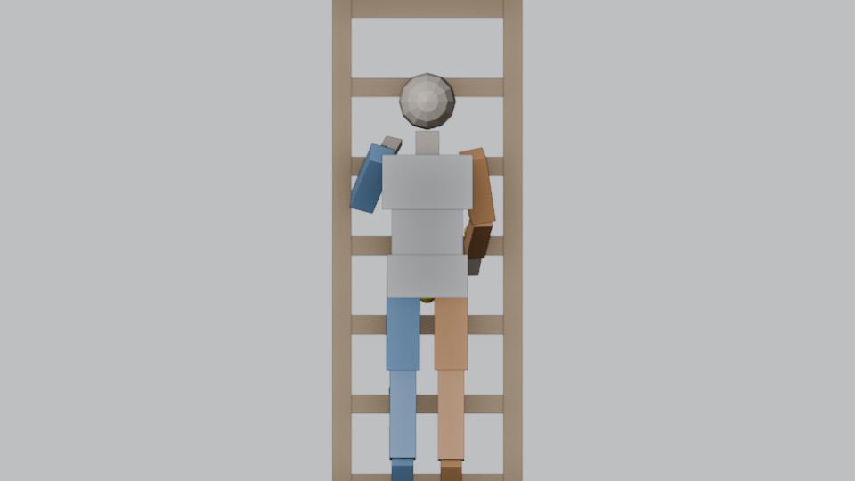 `AirCatch` frame 45 | 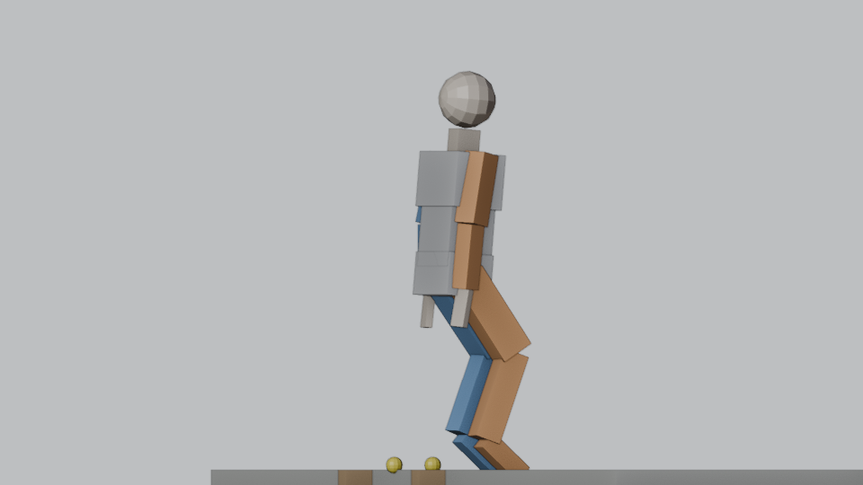 `TopExit` frame 90 |
| 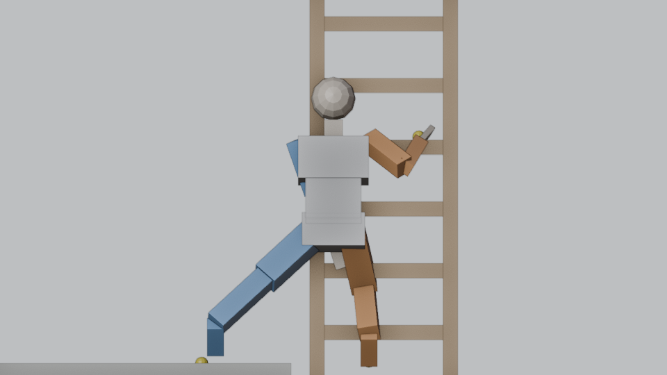 `SideExit` frame 60 | 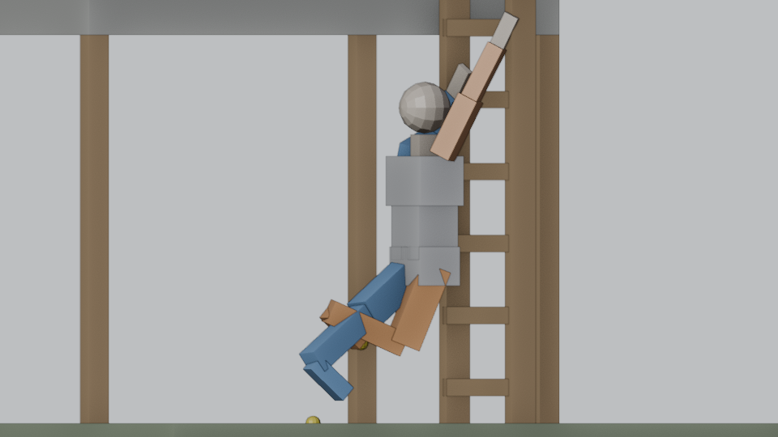 `BottomStepOff` frame 60 |
| 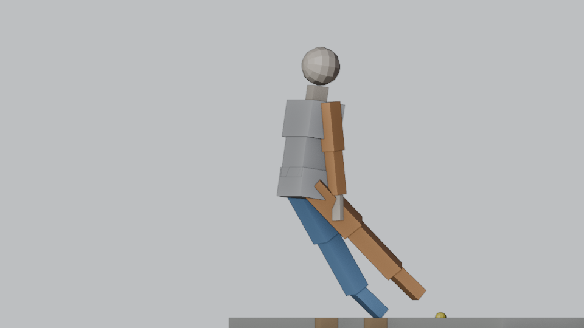 `TopEntry` frame 45 | |

The preview is a picture of the channels, not the game: the proxy is a simple IK humanoid, transition routes are
stand-ins for the runtime's validated route, and the descent preview is shifted by the whole number of rungs the
runtime's reversal match picks (`LimbGait.MatchPhase`).

## Rules the exporter and the game enforce

* Loop windows 0.05–0.7 of a cycle; arc, body and offsets within ±2 m; lean within ±90°; weights and reach 0–1;
  transition seconds 0.05–5; both loops use the same `stride_rungs` (1–6). These are `GaitShape.Valid` and
  `TransitionAction.Valid`; `GeneratedGaitTests.TheExportIsValid` fails on anything else, and at runtime a gait
  that is not valid does not bind (the climb presentation stands down to the game's own pose).
* A loop limb needs at least two keys (its window). Static values must not be keyed. Action and bone names are
  fixed: renaming one makes the export fail closed with a message.
* Presentation only: these values move IK goals, hints and the presented body inside the player's own IK pass.
  Movement, collision, stamina, skill and exits belong to the runtime.

## Reference choices

- Mannequin loop (ScreenRecording 17-00-36): limb order and staggered hand/foot timing, knee-led foot recovery.
- Real climbers (IMG_1944–1947): quieter torso during foot recovery, the larger rise as the leg extends; a distinct
  controlled lowering for the descent.
- Mannequin start (17-00-06): staggered contact entry on mount.
- Game comparison (16-59-05) and playground (17-01-40): the top exit hands the step to the game's own walk; a deep
  mantle crouch is not used for an ordinary floor.

Cadence: one cycle = `stride_rungs` × 1/3 m of travel. At 0.9 m/s (owner decision) that is 1.11 s; with Run
(1.2 m/s) 0.83 s. Climbing speed is gameplay and lives in `Domain/ClimbPolicy.cs`.

## Ownership rules

Movement, collision, stamina, skill and exits belong to the runtime; presentation only writes IK goals, hints and the
body pose inside the player's own IK pass and restores each owned field it still holds. With the hammer out only the
right arm yields to the game's hammer animation. An interact yields both arms, the upper body and the head.

## Known limits

- Fingers keep the native hand pose (no fitted finger curl).
- Other players see the native pose (no observer transport yet).
- The very first frames of a ground mount can be out of reach while contacts fade in (counted, never stretched).
- The preview runs only when Blender is allowed to run the file's script; exporting never needs it.
