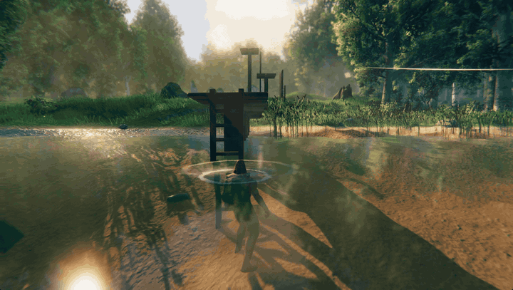
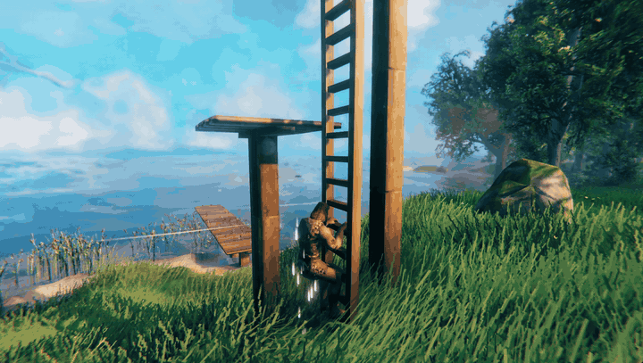
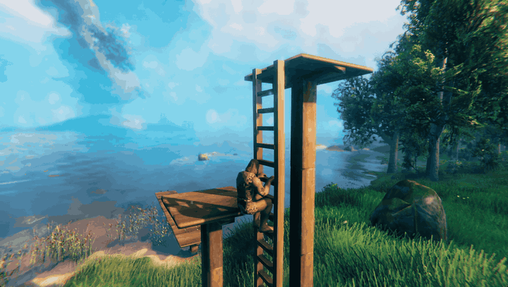
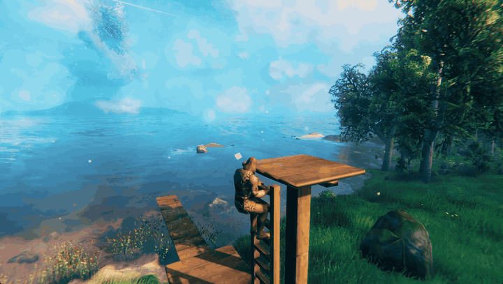
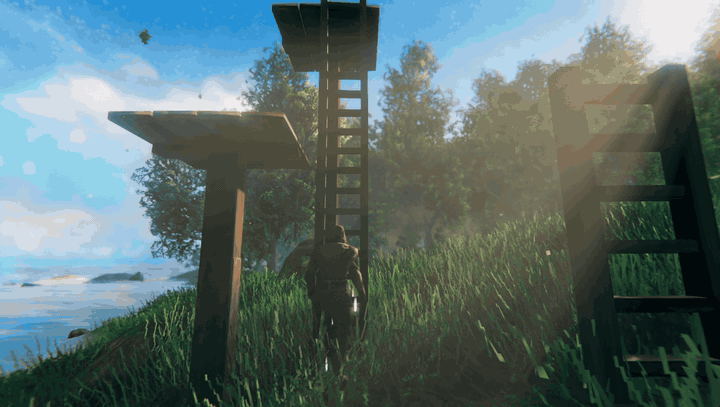
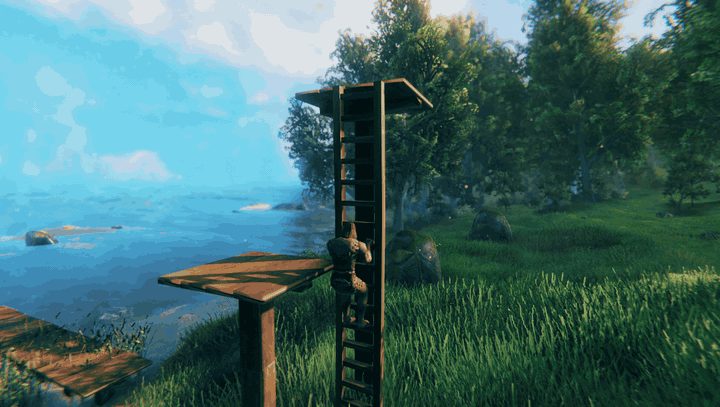
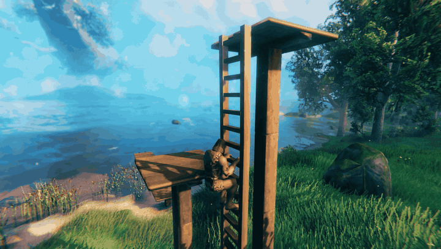
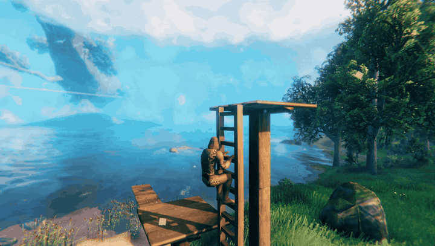

# Concerned Builder

**Formerly Concerned Ladders.** Building for basements and climbs in Valheim: vertical ladders with an
original climbing animation, quick top exits, grabs from the water and in midair, jump-off, drop, side
dismounts, a fast slide and a Climbing skill; floor trapdoors, sloped bulkhead cellar doors, railings and
ladders in every vanilla building material; and an Iron Shovel that digs straight-sided basements. Each part
has its own setting, on by default.

Built against Valheim **1.0.21** with BepInExPack Valheim 5.4.2351 and Jötunn 2.30.2. The ladders, the climb and the
Climbing skill were tested in game on Valheim 1.0.20 as Concerned Ladders 1.0.0; everything Concerned Builder 1.1.0
adds was tested in game in November 2026.

**What it adds**

- **Vertical ladders** in eight materials, with an animated climb and a Climbing skill.
- **Floor trapdoors** and **sloped bulkhead cellar doors**, one for every door in the game, that a ladder climbs through.
- **Railings** for floors, the game's stairs and the step ladder, in eight materials.
- **The Iron Shovel**, which digs basements of ready-made sizes with straight earth sides, joins holes edge to edge,
  digs sideways into its own earth, and fills a hole back in on request.

## Moving from Concerned Ladders

This is the same mod under a new name. Install **ConcernedBuilder** and uninstall **ConcernedLadders**.
The plugin ID and its config file (`com.theconcernedcat.valheim.concernedladders.cfg`) are unchanged, so your
settings, your placed ladders and your Climbing skill carry over, as an update would. Do not keep both packages
installed.

## In action

**Climb out of the water onto a dock.** Swim up to a ladder, press Interact, climb out.

**Climb up and down.** Each hand and foot takes its own rung.

**Step off at the top, or get on from the floor above.**

**Catch a ladder in midair.** Jump, press Interact, and you are on the rungs.

**Jump off, step off to the side, or slide down.**

## Building

Equip the **Hammer** and open the **Building** tab. The ladders use the game's normal resource
discovery: each one appears once you have found its materials.

| Piece | Cost per 2 m section | Needs nearby | Health |
|---|---|---|---|
| Vertical Wood Ladder | 4 Wood | Workbench | 200 |
| Vertical Copper Ladder | 2 Copper, 1 Wood | Forge | 400 |
| Vertical Iron Ladder | 2 Iron, 1 Wood | Forge | 800 |
| Vertical Darkwood, Ashwood, Flametal, Dvergr and Log Ladders | what the game's own pole of that material costs | that pole's station | that pole's |

All of them climb exactly the same. Placement, support, wards, repair, damage and refunds are the
game's own. A free-standing stack follows the game's structural support, so a tall wooden stack
needs bracing against the building (an unbraced wood stack holds about five sections).

**Snapping.** Cycle Snap offers Auto, Bottom, Top, Left side and Right side.

- **Floor:** aimed at a floor, the ladder goes on the floor edge nearest your aim. It hangs below the edge, or stands on it with Bottom.
- **Wall:** aimed at a wall, it goes on the wall face toward you, standing on the wall's bottom edge or hanging from its top edge (Top).
- **Centring:** Auto, Top and Bottom centre it. Left side and Right side line one rail up with that corner, as you face the climbing side.
- **Ladder:** aimed at another ladder, Auto, Top and Bottom extend the column in a straight line.
- **Rotation:** rotating the hammer turns a ladder snapped to a floor or wall up to 45 degrees either way. A turned section does not join the run below it.

## Controls

The ladder uses the game's own bindings, so if you rebind a key in Settings, the ladder follows.
The keys below are the PC defaults.

| Action | Default key | What it does |
|---|---|---|
| Get on | **E** (Interact) | Grab the ladder you are looking at: from the ground, from a floor above, from beside or behind it, in midair while jumping or falling, or while swimming. Reach is about 1.5 m. |
| Climb up / down | **W** / **S** | Climb at 0.9 m/s. Let go of the keys and you hold still. Camera pitch does not matter. |
| Climb faster | **Left Shift** (Run) + W/S | 1.2 m/s, costs stamina. Out of stamina, you keep climbing at normal speed. |
| Slide down | **Left Shift** + **S** at Climbing 20+ | Slide down at 4.5 m/s. Below level 20 this is the faster climb instead. |
| Step off | **E** while climbing | Step onto a floor at the top, a floor beside the ladder partway up, or the ground at the bottom. |
| Jump off | **Space** (Jump) | Hop off upward and in the direction you steer, or straight away from the ladder. It uses the game's jump and stamina. If you are over-encumbered or out of stamina, you just let go. |
| Let go | **Left Ctrl** (Crouch) | Drop where you are and fall normally. |

Near the top, the climber steps onto a floor beyond the rails or to either side. If there is nowhere
to step off, or a closed roof or hatch is overhead, climbing stops about 1.3 m below the top, with
both hands still on the rungs.

You can climb with the hammer out and build, repair or remove pieces while holding on. Removing the
section you are holding makes you fall. A new section built above you extends the climb.

Gamepad buttons are wired to the same game actions, but controller play has not been tested yet.

## Climbing skill

Concerned Builder adds a **Climbing** skill to the game's skill screen.

- **Earning:** you earn Climbing for each whole metre actually climbed at normal or fast speed. Holding still, sliding, jumping and dropping earn nothing, so hanging on a ladder cannot farm it.
- **Effect:** higher levels make fast climbing and sliding cheaper, up to 25% less stamina at level 100.
- **Slide:** level 20 unlocks the slide.
- **Stamina:** fast climbing costs 6 stamina per second and sliding 2 per second, before the skill saving, the world's stamina setting, and the movement modifiers from your equipment and status effects. Normal climbing is free.
- **Saving and death:** the skill is saved with your character and loses levels on death like any other skill.
- **Jump:** a powered jump-off trains the game's own Jump skill. No other vanilla skill is changed.

**Falling.** While you hold on, you take no fall damage. When you let go or jump, the game's normal
fall damage is measured from where you let go.

## Trapdoors and cellar doors

Every door and gate the game lets you build has a matching **trapdoor** (a 2 m floor hatch) and a sloped
**cellar door** (a 2 m bulkhead, like a house's storm-cellar door), in the Hammer's Building tab next to the
ladders. Each reads as its own door: planks, a gate, poles, iron bars, iron-strapped planks, a panel or flametal plates.

| Door | Trapdoor | Cellar door |
|---|---|---|
| Wood Door, Wood Gate, Roundpole Gate, Iron Gate, Darkwood Gate, Timberwood Gate, Hexagonal Gate, Ashwood Door, Flametal Gate | the door's own cost and station | twice the door's cost, same station |

- **Opening:** Use opens and closes it, at the matching door's speed and with its sound. A lid or leaf waits instead
  of swinging into a player, a creature, an item, a cart or a building piece.
- **With a ladder:** aim a ladder at the frame in Auto or Top and it hangs inside the opening. You can open and close
  the lid from the ladder without letting go, and climb out only while it is open; a closed one holds you below.
- **The cellar door** is low at the front and 1.76 m tall at the back, open underneath, so a stair built down from
  the front passes under it, and the front is a step you walk over.

## Railings

Railings snap along a stair's side edge, a floor's edge or another railing, in **wood, copper, iron, darkwood,
ashwood, flametal, dvergr and log**. Wood and the other woods are plain, copper has twisted balusters with a knuckle,
and iron and flametal have twisted bars, scrolls and finials.

| Piece | Fits |
|---|---|
| Half … Railing | 1 m of level floor, a landing's end |
| … Railing | 2 m of level floor |
| 27 … Stair Railing | the game's stairs (26.57 degrees) |
| 45 … Stair Railing | the step ladder (45 degrees) |
| … Newel Post | corners and the ends of a run |

Wood railings cost 1 Wood (half), 2 (level) or 3 (stair) at the Workbench; copper 1 Copper and 1 Wood, iron 1 Iron
and 1 Wood, at the Forge; the other materials cost what the game's own pole of that material costs.

## The Iron Shovel: digging basements

Craft the **Iron Shovel** at the Forge from 10 Iron and 4 Wood, once you have found Iron. Equip it like a weapon.

| Action | Default key | What it does |
|---|---|---|
| Choose a size | **Mouse wheel** | 1x1x1, 2x2x1, 2x2x2, 4x4x1, 4x4x2 or 4x4x4 m. The camera does not zoom while you choose. |
| Dig | **Left mouse** (Attack) | Digs the hole the outline shows. |
| Fill back in | **Middle mouse** (Secondary attack), twice | Fills your last hole back in, exactly as the ground was, newest first, free. |

- **The outline** shows the hole before you dig: green when it will dig, amber when there is nothing to dig, red with
  the reason when it cannot. The bottom panel names the size and what it is for, as the hoe's does.
- **Lining up:** a hole lines up edge to edge with the holes you just dug beside it, so a row of rooms stays straight
  even with mixed sizes; with none beside it, it snaps to a grid of its own size.
- **Straight earth sides:** the ground cannot be cut vertically, so each hole's sloping 1 m border is filled with
  earth blocks in the terrain's own rock, up to the ground beside it. Build a wall against the face; the blocks have
  corner snap points.
- **Digging sideways:** aim at an earth block and dig: the new hole opens flush beside the old one and takes the
  blocks it covers out, so you can tunnel out rooms one hole at a time.
- **Clearing earth:** the hoe's Level and Raise and the pickaxe's dig remove the blocks they reach, so separate holes
  can be joined into one dug-out area; a pickaxe breaks a block in one hit, and the hammer removes it. No refund.
- **What it clears:** plants and stones in the way are picked for you; rocks, stumps, bushes, logs and trees are
  removed. Carts, ships and fixed scenery stop a dig; building pieces are left alone.
- **Rules:** the ground must be within 8 m and the first thing you see; no digging from a ladder, inside a ward that
  does not grant you access, or in no-build areas. A dig costs stamina and durability by the ground it removes: 10
  stamina plus 0.3 per cubic metre (at most 60) and 0.16 durability per cubic metre. The game stops 8 m below
  natural ground, so the deepest floor is 7 m down.
- **Filling back in** is refused once the ground has changed or something stands in the hole. Up to 10 holes can be
  filled back in, until you leave the world.

## Multiplayer

**Every player and the server need the mod, at the same version.** The ladders are custom building
pieces that a game without the mod cannot load. The mod also tells Jötunn that every client and the
server must have it at a matching version, and Jötunn checks that when a player connects.

- **Tested:** single player, with version 1.0.0.
- **Not tested yet:** dedicated servers, hosting for or joining other players, mixed modded and unmodded players, and mismatched versions.
- **Other players' view of a climber:** the climbing animation is applied only in the climber's own game. It is not sent to other players, and what they see has not been tested.

## Configuration

`BepInEx/config/com.theconcernedcat.valheim.concernedladders.cfg`

| Setting | Default | Meaning |
|---|---|---|
| `General` / `ClimbingEnabled` | `true` | Turns climbing on or off. Placed ladders and the Climbing skill stay registered either way. |
| `LadderFamilies` / `Enabled` | `true` | Adds Vertical Darkwood, Ashwood, Flametal, Dvergr and Log Ladders, each made from and costing what the game's own pole of that material costs. Turning it off again makes the game delete placed family ladders when a world loads. In multiplayer every player and the host or server must use the same value. |
| `Railings` / `Enabled` | `true` | Adds railings in eight materials (wood, copper, iron, darkwood, ashwood, flametal, dvergr, log): half (1 m) and full (2 m) level railings, "27" stair railings for the game's stairs (26.57 degrees), "45" stair railings for the step ladder, and a newel post. They snap along a stair's side edge, a floor's edge or another railing. Turning it off again makes the game delete placed railings when a world loads. In multiplayer every player and the host or server must use the same value. |
| `Excavation` / `Enabled` | `true` | Adds the Iron Shovel (Forge: 10 Iron, 4 Wood, once you have found Iron). The mouse wheel chooses a ready-made hole (1x1x1, 2x2x1, 2x2x2, 4x4x1, 4x4x2 or 4x4x4 m) and Attack digs it, with a level floor and straight earth sides (`EarthFill`, on by default: the sloping 1 m border is filled with earth blocks in the terrain's own rock, which the hammer removes, a pickaxe breaks, and the hoe's level and raise clear; aim at one to dig sideways into it); a hole lines up edge to edge with the holes you just dug beside it, otherwise with the world grid. A flat outline and one short line show what will happen. Secondary Attack pressed twice fills your last hole back in (free, newest first). A dig costs stamina and durability by the ground removed, before the world's stamina and durability settings, charged only when a dig is placed. It refuses in wards that do not grant you access and never digs from a ladder; pickables in the way are picked for you and rocks, stumps, bushes, logs and trees are cleared, while carts, ships and fixed scenery still stop it. Also adds a read-only `cl_excavate` console diagnostic. Turning it off again removes the shovel, and the game discards crafted shovels when their inventory loads. In multiplayer every player and the host or server must use the same value. |
| `Trapdoors` / `Enabled` | `true` | Adds nine floor trapdoors to the hammer. Their lids open and close, and a ladder hangs in one and climbs through it when it is open. If you turn it on and place trapdoors, turning it off again (or uninstalling) makes the game delete them, with no refund, the next time the world loads. In multiplayer every player and the host or server must use the same value: a host or server with it off deletes the trapdoors other players place, as soon as they are placed. |
| `CellarDoors` / `Enabled` | `true` | Adds nine sloped 2 m cellar doors to the hammer, at twice the matching door's cost. Both leaves open and close together with the door's Use, and wait instead of moving into a player, a creature, an item, a cart or another building piece. A ladder aimed at one in Auto or Top hangs inside its opening, and a climber gets in or out over its front panel only while both leaves are open; ladders never treat a cellar door as a floor. Turning it off again (or uninstalling) makes the game delete placed cellar doors, with no refund, the next time the world loads. In multiplayer every player and the host or server must use the same value: a host or server with it off deletes the cellar doors other players place, as soon as they are placed. |

## Known limitations

- Other players do not see the climbing animation (see Multiplayer).
- Multiplayer, dedicated servers and controllers are untested.
- Uninstalling deletes placed ladders and resets the Climbing skill (see Uninstalling).
- A free-standing wooden stack taller than about five sections falls apart on reload because of vanilla structural support. Brace it, or use copper or iron.
- Grabbing from the water: the swimmer bobs, so it can take a second Interact to aim at the ladder.
- Concerned Foreman's own ladder climbing conflicts. While it is active, Concerned Builder refuses to mount and says so. Turn off Foreman's `Ladders/Enabled` and restart to use both mods.

## Troubleshooting

- **No ladders in the build menu.** Open the Hammer's Building tab. You may not have discovered the materials yet: Wood for the wooden ladder, Copper or Iron for the metal ones.
- **"Move closer to climb".** Stand within about 1.5 m of the rungs and look at the ladder.
- **Run does not climb faster.** You are out of stamina.
- **Run + S does not slide.** Climbing is below level 20.
- **Can't connect to a server.** Install the same Concerned Builder version on the server and every client.
- **Reporting a bug.** Attach `BepInEx/LogOutput.log`. The mod's startup line shows its exact version.

## Uninstalling

**Remove every ladder from your world first, while the mod is still installed.**
Tested 2026-10-27 on a disposable world and character:

- **Placed ladders:** if the world is loaded without the mod, the game deletes every placed ladder for good and refunds nothing. Reinstalling does not bring them back.
- **Climbing skill:** a character loaded without the mod loses the skill, and it is back at 0 after reinstalling.
- **Everything else:** floors and walls built around the ladders, and every other skill, were unaffected.

With the building settings on (the default), placed trapdoors, cellar doors, railings, family ladders and earth
blocks are deleted the same way, and crafted Iron Shovels are discarded when their inventory or chest loads. Holes
already dug are the game's own terrain edits and stay, with sloping sides once their earth blocks are gone.

To keep everything, deconstruct the ladders with the hammer before removing the mod. Turning off
`ClimbingEnabled` instead keeps both the ladders and the skill.

## Credits and license

Made by **The Concerned Cat** (Eren Cansunar), developed with AI coding assistance. The climbing
animation is original, authored in Blender for this mod. The ladders reuse the game's own materials
at runtime. No game files are bundled.

MIT License (see `LICENSE` in this package). Requires
[BepInExPack Valheim](https://thunderstore.io/c/valheim/p/denikson/BepInExPack_Valheim/) and
[Jötunn](https://thunderstore.io/c/valheim/p/ValheimModding/Jotunn/).

## Support

- Bugs and suggestions: <https://github.com/Weakened/ConcernedCatMods/issues>
- Private or sensitive reports: <support@theconcernedcat.com>
